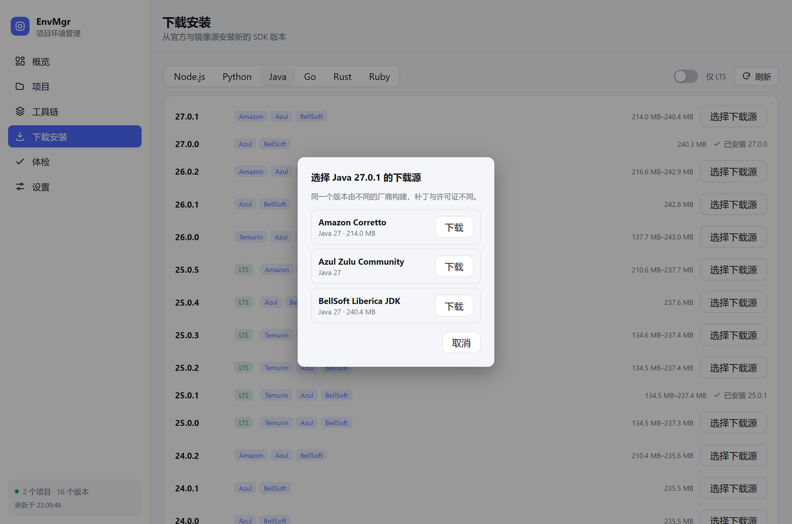
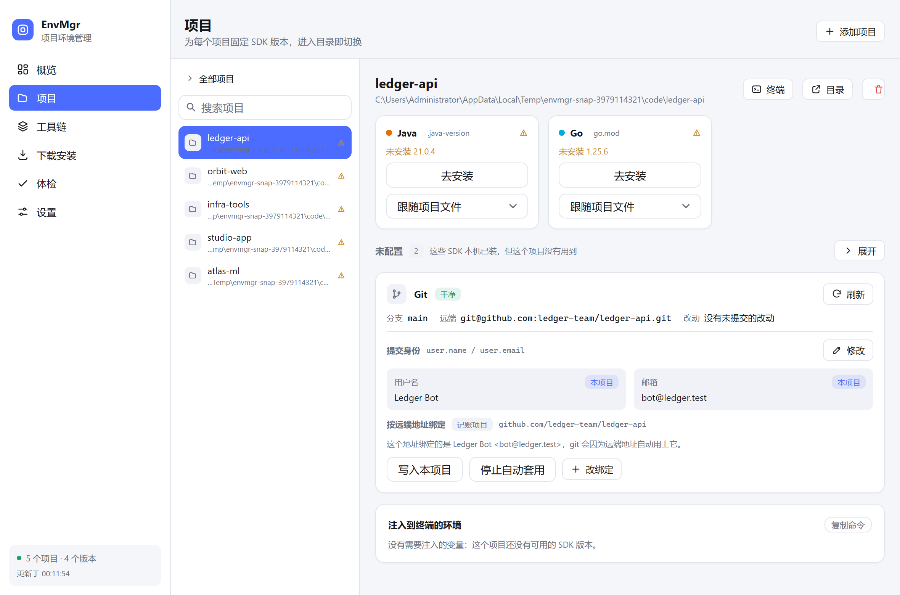
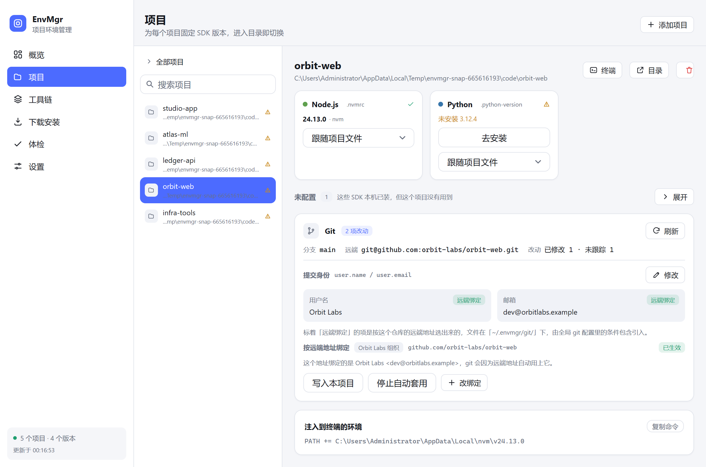
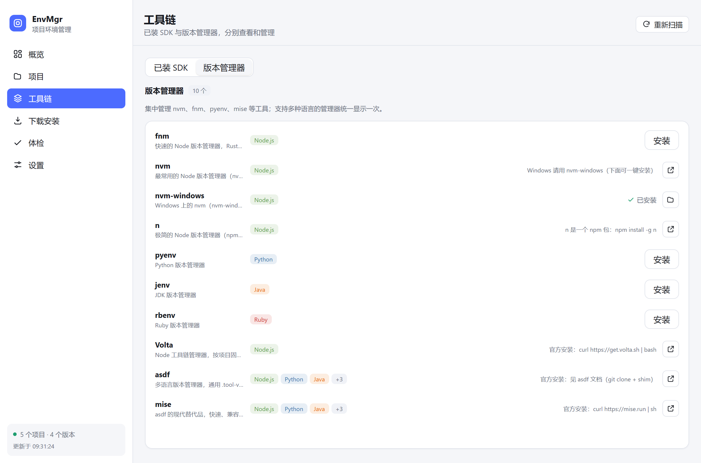

# EnvMgr · 项目环境管理

按项目切换 SDK 版本，不动全局环境变量。Windows、macOS、Linux 同一个可执行文件，Go + mygo 原生 GPU 界面，无 cgo、无 WebView。

```
┌ EnvMgr ─────────────────────────────────────────────┐
│ 概览   项目环境、已装 SDK 与需要处理的问题           │
│ ─────────────────────────────────────────────────── │
│ 读取项目已有的 .nvmrc / .python-version / java-version │
│ 进入目录自动切换；不动全局环境变量                     │
└─────────────────────────────────────────────────────┘
```

## 它解决什么

同一台机器上，A 项目要 Node 18，B 项目要 Node 24，C 项目要 Python 3.11，D 项目要 Python 3.12。改全局 PATH 只能让一个项目赢，且会悄悄弄坏别的项目。

EnvMgr 的做法：

- 每个项目的版本写在项目里（`.envmgr.json`，或项目原有的 `.nvmrc`、`.python-version`、`go.mod`、`rust-toolchain.toml`、`.tool-versions`……）。
- 需要环境时，把该项目的 SDK 目录**临时**放到 PATH 最前面 —— 只对这个终端、这个进程有效。
- 系统环境变量、`~/.bashrc`、`~/.zshrc`、注册表 PATH 一律不写。是否安装 shell 钩子由你自己决定，钩子内容只打印给你看，不代写。

## 界面

五个页面，鼠标能做完所有事：

| 页面 | 用途 |
| --- | --- |
| 概览 | 项目数、已装版本数、待处理缺失版本、最近项目、各 SDK 最新版本 |
| 项目 | 左侧项目列表（可搜索），右侧按 SDK 选版本；卡片上显示每个项目的提交地址（有名字显示名字，没名字显示域名）；Git 卡显示仓库状态、提交身份与远端地址绑定 |
| 工具链 | 「已装 SDK」按语言查看版本及来源；「版本管理器」独立集中展示管理工具及安装入口 |
| 下载安装 | 从官方源列版本、下载、校验、安装；Java 多来源可选；LTS 过滤；内联进度 |
| 设置 | 主题（跟随系统/浅色/深色）、跟随项目文件开关、SDK 安装目录、Node 镜像、shell 钩子片段、Git 地址绑定管理 |

浅色深色都跟随系统，也可以手动锁定。

## 下载安装

顶部是 SDK 标签（Node.js / Python / Java / Go / Rust / Ruby）。切标签时页面会自己判断该显示谁的数据：每帧问一次「当前标签的列表在手上了吗」，没有就拉，拉过就直接用缓存 —— 切回上一个标签不会重新请求。

判断逻辑抽成了 `remoteActionFor`，有五种答案：显示列表 / 等待中 / 显示错误 / 用缓存 / 去拉取。这样 tab 切换、从项目页跳进来、点「刷新」都走同一条路，不依赖某个控件的回调有没有触发。

### Java 是多来源的

同一个 Java 版本由多个厂商各自构建，补丁节奏和许可证都不同，所以 Java 的列表是**版本 × 来源**的矩阵：一行一个版本，行内是能提供这个版本的厂商，点「选择下载源」再选具体构建。




| 来源 | 地址 | 能列出 |
| --- | --- | --- |
| Eclipse Temurin | `api.adoptium.net` | 每个大版本的完整小版本历史 |
| Amazon Corretto | `corretto.aws` | 每个大版本的最新构建 |
| Azul Zulu Community | `api.azul.com/metadata` | 完整小版本（已剔除 CRaC / JavaFX 变体） |
| BellSoft Liberica JDK | `api.bell-sw.com` | 完整小版本（只取普通 JDK 压缩包） |
| Microsoft Build of OpenJDK | `aka.ms/download-jdk` | 每个大版本的最新构建 |

覆盖 Java 8 / 11 / 17 / 21 / 25 / 26 / 27 等，一共约 380 个构建。四个细节值得说明：

- **版本号归一**：Corretto 报 `21.0.13.0.11`、Liberica 报 `21.0.13+11`、Microsoft 报 `21.0.13.0.2`，归一成 `21.0.13` 才并得成一行。
- **一个源挂了不影响整页**：任一厂商取列表失败只记下原因，别的厂商照常显示；全部失败才报错。
- **同版本不同源不打架**：默认源（Temurin）装到 `~/.envmgr/sdk/java/<版本>`，其他源装到 `<版本>-<来源>`，两个构建可以并存。
- **Adoptium 的分页要小页翻**：它的 `page_size` 一大就会跳进历史中段、甚至直接 404，用 30 去取会把 Java 21/25/27 取成空列表。现在固定用小页（每页 3 条）逐页往回翻，最多 18 个构建 —— 这既是修掉「21 之后一个都没有」的原因，也让每个大版本都有从新到旧的完整序列。

命令行同样能指定来源：

```bash
envmgr list --remote java           # 列出来源与版本
envmgr install java@21.0.13@corretto
```

IBM Semeru 与 Oracle 的 OpenJDK 构建没有稳定的公开版本索引（Semeru 只有 Java 8 的部分索引，Oracle 的下载地址带不可推导的 hash），所以没有列入；用「导入本机已装」仍然可以纳管它们。

## 项目页

项目页是两级：默认是卡片墙，点开一张卡才进入配置。

**卡片墙**：四栏网格，所有项目一屏铺开。每张卡显示项目名、路径、它固定了哪些版本、以及还有几个版本没装。缺失的卡片带一个橙色感叹号，一眼能看出哪个项目跑不起来。

**项目配置**：列表收缩成左侧窄栏（仍可搜索、仍标注缺失），右侧是该项目自己的配置：

- 三栏卡片，一张卡一个 SDK —— 颜色点、来源（`pin` / `.nvmrc` / `go.mod` / `默认` 等）、当前解析到的版本与来源管理器、切换下拉。
- 这个项目**没用到的** SDK 收在「未配置 N」后面，默认折叠；点「展开」才显示，并且用淡色画出来 —— 它们在本机可用，只是这个项目不关心。

### 任意子目录都算这个项目

版本声明按目录向上查找：在 `src/`、`internal/api/` 里打开终端，用的是最近的项目根（`.envmgr.json`、`.nvmrc`、`.python-version`、`go.mod` 等）声明的版本，和 nvm / pyenv 的行为一致。子目录自己带声明时以子目录为准 —— 一个仓库里可以同时有 Node 18 的前端和 Node 22 的工具链。

缺失的版本不再让整个环境失效。项目要 Go 1.27.4 和 Java 21.0.9，而只有 Java 装好时，进入目录会切到 Java，并把「缺少 Go 1.27.4」打印在终端；`envmgr run`、终端按钮和一键就绪仍然严格，缺任何一个版本都拒绝启动，避免悄悄用到系统里的另一个版本。

进入项目时读取的是最近一次扫描的快照（`~/.envmgr/discovery.json`，60 秒内有效），所以每次 `cd` 不再重新探测所有 SDK：首次约 200ms，之后通常在 10ms 内。超过 60 秒会重新扫描一次，外部工具刚装的版本也能被看到。

### 项目之外的全局默认版本

离开项目就什么都不切换，是 asdf / mise 用户最先不习惯的地方。设置页的「全局默认版本」可以给每个 SDK 指定一个兜底版本，命令行是 `envmgr default node@20.11.1`：此后没有声明该 SDK 的目录都用它，项目自己写了版本时仍以项目为准。设置值在保存时解析成当时匹配到的确切版本，不会指向一个没装的东西。

那个版本后来被删掉时，默认自动失效，不会在每个目录里报错；`envmgr default` 会把它标成「本机已没有」。删除一个正被默认使用的版本会被拒绝，和仍被项目固定的版本一样，确认后加 `--force`。

### 项目里的 Git

项目页的 Git 卡按「远程仓库 → 分支与改动 → 提交身份 → 项目代码统计」排列。远端下拉以别名为名称、仓库 URL 为值；选择后保存为本仓库的默认推送目标。分支下拉包含所有本地分支及所选远端已经获取的分支，支持切换、新建并切换、删除已合并的非当前本地分支；「获取分支」才会连接所选服务器更新引用，普通刷新和页面绘制只读取本地数据。

分支操作由 Git 检查未提交改动、名称冲突和合并状态，不执行强制切换或强制删除。改动数据来自当前本地工作区，领先/落后来自本地缓存的 upstream 引用；切换不同远端不会把同一工作区伪装成不同的文件改动。

代码统计在后台执行，可单独重新统计，展示源文件数、非空行、空白行、体积和语言分布。非空行包含注释，文档与配置不计作源代码；Git 仓库使用跟踪与未忽略文件列表，排除依赖、构建目录和符号链接。扫描有文件大小、数量、读取量与时间上限，达到上限或发生读取错误时显示部分结果。切换项目会取消过期任务，分支操作后自动更新统计。

| 状态 | 卡片长什么样 |
| --- | --- |
| 没装 git | 「未安装」，给一个 git-scm.com 的入口 |
| 目录不是仓库 | 「不是仓库」+「初始化 Git 仓库」按钮，说明只创建 `.git`、不动项目文件 |
| 刚 `git init` | 「还没有提交」—— 还没提交过的仓库不该被当成游离 HEAD |
| 游离 HEAD | 「游离 HEAD」，不会把 `HEAD` 当成一个分支名显示 |
| 有提交、干净 | 「干净」+ 分支名 |
| 有改动 | 「N 项改动」+「已暂存 / 已修改 / 未跟踪」分别计数 |



**身份来自哪一级，卡片直接标出来**。这是它存在的理由：git 本身没有「项目身份」这个概念，`user.name` 只有仓库级和全局两级，项目里的值是继承来的。卡片对每一项单独标注来源：

- 标「本项目」—— 写在 `.git/config` 里，只影响这个仓库；
- 标「全局」—— 沿用 `~/.gitconfig`，这台机器上所有仓库共用；
- 标「未设置」—— 两级都没有，`git commit` 会直接拒绝执行。

点「修改」写的就是 `.git/config`，**永远不碰全局配置**。留空保存等于删掉本项目这一级，值会立刻回退到全局 —— 和 git 自己的行为一致，不用记另一套规则。


两个实现上的细节值得说：

- **分支名用 `symbolic-ref --short HEAD` 读，不用 `rev-parse --abbrev-ref HEAD`**。后者在刚 `git init`、一次提交都还没有时返回 `HEAD`，会被误判成游离头指针。实测确认过：新建仓库的 `symbolic-ref` 给出 `master`，`abbrev-ref` 给出 `HEAD`。
- **`git status --porcelain` 的输出不能 `TrimSpace`**。它的第一列是暂存区状态，`" M file"`（已修改）前面那个空格是数据；统一 trim 掉就变成 `"M file"`（已暂存），计数全错。这个 bug 是真 git 测试抓出来的，不是想出来的。

`git status` 在大型仓库上可能很慢，项目页绘制只读取缓存：首次显示「读取中」并在后台加载，之后过期先显示旧值、后台更新。「刷新」按钮保留旧缓存，并与已有读取合并。Git 读取完成只触发重绘，不触发 SDK 扫描；普通状态通知合并为后台快照更新，主动刷新才执行全量 SDK 扫描，避免「扫描结束通知 → 再扫描」的反馈循环。

命令行状态与身份操作：

```bash
envmgr git                          # 当前目录的仓库状态与提交身份
envmgr git app                      # 按项目名查
envmgr git init --dir <目录>        # 变成仓库
envmgr git set --name 张三 --email z@ex.com --dir <目录>
                                    # 只写本项目的 user.name / user.email
envmgr git set --clear --dir <目录>  # 删掉本项目设置，回到全局
```

### 多个远端地址与多套身份

一个项目可以同时保存 GitHub、Gitee、Gitea 等多个远端，每个地址又可以保存多套用户名和邮箱。Git 卡顶部选择远端，提交身份区域的「身份库」管理对应地址的资料。

1. 点「添加地址」，填写远端别名和 URL，例如 `github`、`gitee`、`company`。顶部下拉显示别名和地址，已有地址可以编辑或移除。
2. 在下拉中选择地址后，点「身份库」查看它对应的身份。点「为此地址新增身份」保存另一套用户名和邮箱，原身份继续保留。
3. 点「应用」，把选中的用户名和邮箱写入当前仓库的本地 Git 配置；提交身份区域显示实际生效的值。
4. 点「编辑」只修改这一套身份；设置页删除身份也只删除所选的一套。同一地址的其他身份保持可用。

地址名称用于区分项目中的远端；身份的显示名用于区分公司、个人等身份。未命名身份仍按地址域名显示。旧版保存的一套地址身份自动兼容，继续显示并可新增其他身份。

**一次 Git 提交只有一套署名。** 选择地址会切换远端上下文并保存本仓库的默认推送目标；需要改变下一次提交的 `user.name` / `user.email` 时，在身份库里点「应用」，或直接修改身份。已有的当前分支推送覆盖项也会指向所选远端，其他分支的覆盖项和 upstream 保留。同一提交推送到不同平台会保留同一署名；历史提交保持原样。远端认证仍由 Git 的凭据或 SSH 配置负责。

地址会被归一化：去掉协议、凭据、端口和结尾的 `.git`，主机小写。组织级、主机级绑定仍可复用到下属仓库，每条身份都有独立 ID，编辑、应用和删除均可按 ID 精确定位。



命令行示例：

```bash
envmgr git remote add github https://github.com/acme/app.git --dir <项目目录>
envmgr git remote add gitee git@gitee.com:acme/app.git --dir <项目目录>
envmgr git remote list --dir <项目目录>

envmgr git profile add github.com/acme --label 公司 --name Work --email work@acme.dev
envmgr git profile add github.com/acme --label 个人 --name Personal --email me@example.dev
envmgr git profile list
envmgr git profile use <身份ID> --dir <项目目录>
envmgr git profile rm <身份ID>
```

保存身份本身只保存资料。可选的 `envmgr git rules install` 会在全局 Git 配置里增加带标记的条件包含块，为每个地址生成当前选中的默认身份；原文件备份为 `.envmgr.bak`。保存或切换身份会刷新已经安装的规则；未安装规则时保持未安装状态。`envmgr git rules uninstall` 移除这个块。全局环境变量保持原样。

多远端仓库可能同时命中多条 `includeIf`，Git 不会因将来推送到哪个远端而重新选择提交身份。因此项目页的显式「应用此身份」写入本地配置，优先于条件包含和全局默认值，确保当前项目的下一次提交署名明确。

## 体检

窗口的「体检」页把 EnvMgr 依赖的每一项配置逐条查一遍，命令行是同一份结果：

```bash
envmgr doctor                 # 全部检查项
envmgr doctor --dir <目录>    # 只看某个目录解析成什么
```

检查分六组，有问题和需要注意的排在前面：

| 分组 | 查什么 |
| --- | --- |
| 运行环境 | Go 版本、OS/架构、可执行文件位置 |
| 数据与存储 | 配置目录与 SDK 目录能否创建和写入、状态文件大小、下载缓存占用 |
| 终端集成 | 当前 shell、每个 profile 的钩子是否安装、是否有 BOM、钩子调用的程序是否还在、进入提示开关、可用终端 |
| 工具链 | 每种 SDK 发现了几个版本、哪个一种都没有 |
| 项目 | 每个项目的版本声明能否落地、缺失的具体版本、手动添加的记录 |
| 设置与环境变量 | 跟随版本文件、SDK 目录、Node 镜像、`GOROOT`/`JAVA_HOME` 等是否指向已消失的目录 |

状态分四级：正常、注意、有问题、信息。能自动处理的项目会直接给按钮（安装终端钩子、重新扫描、打开目录），其余只给说明 —— 比如系统环境变量 EnvMgr 不会去改，只把问题指出来。

## 命令行

窗口之外，同一份核心逻辑也提供命令，方便写进脚本和 CI：

```bash
envmgr                                   # 打开窗口
envmgr env --shell pwsh                  # 打印激活脚本，交给 shell 执行
eval "$(envmgr env)"                     # bash / zsh 里直接生效
envmgr run -- npm test                   # 用项目的 Node 跑一条命令
envmgr use node@20.11.1 python@3.12.4    # 固定版本，写入 .envmgr.json
envmgr default node@20.11.1              # 目录没声明 Node 时默认用它
envmgr default                           # 看当前的全局默认版本
envmgr default --unset node              # 取消 Node 的默认版本
envmgr list                              # 本机已装
envmgr list --remote node                # 官方源可装的版本
envmgr outdated                          # 已装版本 vs 同系列最新、维护截止日期
envmgr upgrade --pin                     # 升到同系列最新，并改写项目里确切版本
envmgr install python@3.12.4             # 下载并安装
envmgr remove node@20.11.1               # 删除 EnvMgr 装的版本
envmgr remove node@20.11.1 --force       # 项目仍在用这个版本时也删除
envmgr doctor                            # 每个项目要的版本是否都在本机
envmgr hook bash                         # 打印可选安装的 shell 钩子
envmgr git                               # 当前目录的仓库状态与提交身份
envmgr git init                          # 把当前目录变成 Git 仓库
envmgr git set --name 张三 --email z@ex.com  # 只写本项目的 user.name / user.email
envmgr add ~/code/app                    # 加入项目列表
envmgr scan ~/code                       # 在目录下找工作项目
envmgr add-version java ~/env/java/17    # 登记一个不在常规位置的已安装版本
envmgr forget-version java ~/env/java/17 # 取消登记（不删磁盘文件）
```

`envmgr run` 会把命令解析到**项目固定的那个版本**上（先按覆盖后的 PATH 找可执行文件，再启动），退出码原样返回，可以直接放进脚本。

`envmgr env` 在部分版本缺失时仍导出已经解析的 SDK，并把缺失项写到 stderr（退出码 0），这样钩子不会因为一个版本没装而丢掉整个环境；`envmgr run` 保持严格，缺任何一个版本都不启动。`envmgr remove` 默认拒绝删除仍被项目使用、或仍是全局默认的版本，确认后再加 `--force`。

## 更新与维护状态

每个已装版本都被放回**它自己所属的发布线**里比较：Node 与 Java 按大版本（20、21），Python 与 Go 按 `3.12`、`1.27` 这样的次版本线，Rust 按 1.x。所以 20.11.1 不会被提示"该升到 22"，同一条线里的补丁与小版本才会被算作更新。

```bash
envmgr outdated                # 每个已装版本 vs 同系列最新、维护截止日期
envmgr outdated --json         # 给脚本用
envmgr outdated --refresh      # 跳过缓存重新问一遍
envmgr upgrade                 # 升级 EnvMgr 安装的、同系列内有更新的版本
envmgr upgrade node@20         # 只升级匹配的那一个
envmgr upgrade node@20 --pin   # 顺带把项目里写死的确切版本改掉
envmgr upgrade --dry-run       # 只看计划，不动磁盘
```

维护状态来自 [endoflife.date](https://endoflife.date) 的发布日程，按 24 小时缓存。拿不到日程时只是少一列"维护"，不会拦住更新检查；某个下载源暂时不可达也只影响那一个 SDK，其余照常给出结论。

窗口里同样能看到：概览的体检条会写"N 个版本可更新"，工具链页每个版本行给出"升级到 x.y.z"按钮，已停止维护的系列带一枚红色标记，即将到期的显示"还有 N 天"。

升级有三条边界：

- **只升同一条线**。跨大版本（Node 20 → 22）只提示"新系列"，绝不自动做。
- **只升 EnvMgr 自己装的版本**。nvm、pyenv、fnm 的版本由各自的工具管，EnvMgr 只给结论；Rust 工具链交给 `rustup update`。
- **旧版本不删**。别的项目可能还固定着它，升级后命令会列出"仍有 N 个项目固定着旧版本"。`--pin` 只改写 `.envmgr.json` 里写死的确切版本；`.nvmrc` 这类别的工具拥有的文件只提示、不代写。

## 项目一键就绪与安装任务

项目详情的「一键就绪」会先解析项目声明，并检查全部缺失 SDK 是否有匹配的可下载版本；检查通过后依次安装，最后执行每个 SDK 的版本命令，核对实际版本。已安装的 SDK 直接验证；Ruby 等需要手动导入的 SDK 会给出明确说明。Java 自动安装优先使用默认来源 Temurin。

下载安装页的「任务与历史」显示下载、校验、解包、安装等阶段，提供取消、失败原因和重试。取消会等待后台任务退出，未完成的解包目录会清理；下载保留断点文件，重试可继续下载。项目就绪任务也在项目详情显示。历史保留本次运行最近 50 条完成、失败或取消记录，关闭应用后清空。

项目声明的 SDK 缺失或配置损坏时，`envmgr run`、激活脚本导出和终端按钮会报错，避免意外使用系统中其他版本。项目配置是版本固定的统一来源，GUI、CLI 和外部修改都在后续解析时生效；`use` 合并已有固定版本，保留其他配置字段。状态更新使用跨进程文件锁与原子写入，GUI 与 CLI 可同时使用。

## 工具链与版本管理器

工具链页顶部有「已装 SDK」和「版本管理器」两个独立入口。前者按 Node.js、Python、Java 等语言查看已装版本及来源；后者集中查看 nvm、fnm、pyenv、mise 等管理工具，保留安装、状态、目录和官网入口，多语言管理器统一显示一次。两份列表分别保存滚动位置，SDK 列表为空时可通过「查看版本管理器」跳转。

「已装 SDK」的每一行还会显示发布状态：有新版本时给出「升级到 x.y.z」按钮（仅 EnvMgr 自己装的版本），系列已停止维护时带红色标记，三个月内到期时显示剩余天数。顶部「检查更新」会重新问一次下载源与发布日程。



## 添加已安装的版本

自动扫描覆盖常规位置，但每个人的机器都有自己的放法。工具链页「已装 SDK」中的 **＋ 添加已安装版本** 用来补这个缺口：

1. 选 SDK 类型
2. 选目录（原生目录对话框）
3. 版本号留空即从目录自动识别

登记后它和扫到的版本完全一样：能显示来源「手动添加」、能给项目固定、能被 `envmgr run` 用上。移除时只从列表里去掉，**磁盘文件不碰** —— EnvMgr 没创建它，就不该删它。

## 自动扫描的范围

| SDK | 扫描位置 |
| --- | --- |
| Node | `~/.envmgr/sdk/node`、`$NVM_DIR/versions/node`、`$NVM_HOME`、`%APPDATA%/nvm`、fnm、n、volta、asdf、mise |
| Python | `~/.envmgr/sdk/python`、pyenv、asdf、mise、uv、`%LOCALAPPDATA%/Programs/Python`、`C:\Python3xx`、macOS Framework |
| Java | `~/.envmgr/sdk/java`、jenv、sdkman、asdf、mise、`/usr/lib/jvm`、**`~/env/java`（多版本并列的常见布局）**、`~/.jdks`、`~/java`、`~/jdks`、`C:\Program Files\{Java,Eclipse Adoptium,Microsoft,Zulu,Amazon Corretto,BellSoft}` |
| Go | `~/.envmgr/sdk/go`、`~/sdk`、asdf、mise、`~/env/go`、`~/go/sdk`、`/usr/local/go`、`GOROOT`、**`GOTOOLCHAIN` 模块缓存** |
| Rust | `~/.envmgr/sdk/rust`、rustup、asdf、mise、PATH |

Java 目录额外识别几种包装结构：`Contents/Home`（macOS 包）、`Home`、`jre` 子目录，以及目录里再套一层版本目录的归档式布局。版本号优先读 `release` 文件里的 `JAVA_VERSION`，读不到再看目录名。

### Go 的 1.27.3 是从哪来的

`go.mod` 里写 `go 1.27.3`，而本机 GOROOT 是 1.25.6 时，Go 自己会下载这份工具链，放在

```
%USERPROFILE%\go\pkg\mod\golang.org\toolchain@v0.0.1-go1.27.3.windows-amd64
```

`go env GOROOT` 指的就是这里 —— 它不是常规安装，但确实是一个能编译的工具链，所以 EnvMgr 照样列出来，来源标成「Go 工具链缓存」。要一个正经安装，就去下载页装一份到 `~/.envmgr/sdk/go`。

## 终端按钮怎么拿到正确版本

「终端」按钮打开的窗口里，SDK 就是项目固定的那个。这件事比看起来难，因为**多数现代终端不是自己去启动 shell 的**：

- Windows Terminal 是单实例程序。`wt -d 目录` 只是把请求转交给已经在跑的进程，新标签页由**那个进程**创建，调用方传的环境变量被整份丢弃。
- Linux 的 gnome-terminal 同理，真正的父进程是常驻的 `gnome-terminal-server`。
- macOS 的 Terminal.app 也不继承调用方的环境。

所以「启动终端时带上环境」这条路根本走不通 —— 走通的是让 **shell 自己应用**环境：EnvMgr 把环境写成一份脚本放到 `~/.envmgr/activate/`，再让新 shell 以「加载这份脚本」的方式启动。Windows Terminal 用 `pwsh -NoExit -File <脚本>`，Linux 用 `sh -c '. <脚本>; exec $SHELL'`，macOS 用生成的 `sh` 脚本。脚本名按环境内容哈希，同一个项目的环境复用同一个文件。

脚本在 shell 的 profile 之后执行，所以即使用户 profile 里改过 PATH，项目的版本依然排在前面。

### 让「自己开的终端」也生效

上面说的是 EnvMgr 打开的终端。你自己开的终端要自动切换，需要装一次钩子：

```bash
envmgr hook pwsh --install     # 写入 shell 启动文件（原文件自动备份）
envmgr hook pwsh               # 看状态：每个启动文件是否已装
envmgr hook pwsh --uninstall   # 移除，只删自己那段
```

装好后进入带版本声明的目录自动切换，离开自动还原 —— 每次切目录先回到基线再叠加，反复进出不会让 PATH 越滚越长。

Windows 上有个必须处理的地方：**PowerShell 5.1 和 PowerShell 7 用的是不同的 profile，一台机器通常两个都在**，而你的终端可能是其中任意一个。所以安装会写进**所有已存在的** profile：

```
~\Documents\PowerShell\Microsoft.PowerShell_profile.ps1          (PowerShell 7)
~\Documents\WindowsPowerShell\Microsoft.PowerShell_profile.ps1   (Windows PowerShell 5.1)
```

并且写入时带 **UTF-8 BOM**。5.1 在没有 BOM 时按 ANSI 解码，块里的中文注释会变成乱码，整段脚本解析失败、静默不生效 —— 这个坑踩过一次。

进入项目时会给一行彩色提示，每种 SDK 用自己的颜色：

```
  ◆ EnvMgr  manager
    java 21.0.9 · go 1.27.4
```

颜色只在终端里显示，重定向或管道里是纯文本，不会污染脚本输出。嫌吵就设 `ENVMGR_NO_BANNER=1`（或写进 profile），提示关掉、切换照常。

EnvMgr 自己打开的终端（终端按钮）也打印同一行提示 —— 用的是同一份 overlay，两种入口看到的东西一致。

钩子里调用的是 EnvMgr 的绝对路径（因为 EnvMgr 所在目录通常不在 PATH 上），所以**移动了 `envmgr.exe` 之后要重装一次钩子**。

`envmgr env`、`envmgr run`、终端按钮、钩子走的是同一份 overlay，四处行为一致。

## 构建

```bash
go build -o envmgr ./cmd/envmgr          # 当前平台
```

要求 Go ≥ 1.27.3（mygo 的下限）。跨平台全部通过 `CGO_ENABLED=0` 交叉编译：

```bash
GOOS=windows GOARCH=amd64 CGO_ENABLED=0 go build -trimpath -ldflags "-s -w" -o dist/envmgr-windows-amd64.exe ./cmd/envmgr
GOOS=linux   GOARCH=amd64 CGO_ENABLED=0 go build -trimpath -ldflags "-s -w" -o dist/envmgr-linux-amd64       ./cmd/envmgr
GOOS=darwin  GOARCH=arm64 CGO_ENABLED=0 go build -trimpath -ldflags "-s -w" -o dist/envmgr-darwin-arm64      ./cmd/envmgr
```

产出约 12–14 MB，静态链接，不需要运行时装任何 SDK 或 WebView。

## 数据放在哪

| 内容 | 位置 |
| --- | --- |
| 配置与项目列表 | `~/.envmgr/state.json`（跨进程锁、原子写入；损坏时保留原文件并报错） |
| 最近一次发现结果 | `~/.envmgr/discovery.json`（60 秒内有效；`env` 走缓存，缺失或过期时重扫） |
| 发布日程缓存 | `~/.envmgr/lifecycle.json`（24 小时有效；只存各系列的维护截止日期） |
| EnvMgr 装的 SDK | `~/.envmgr/sdk/<kind>/<version>` |
| 版本管理器 | `~/.envmgr/managers/<id>` |
| 下载缓存 | `~/.envmgr/downloads` |
| Rust 私有工具链 | `~/.envmgr/.rustup`、`~/.envmgr/.cargo` |
| Git 地址绑定的身份文件 | `~/.envmgr/git/<地址>.gitconfig` |

安装目录可在设置里改。EnvMgr 只写这些目录。

## 支持的 SDK 与来源

| SDK | 发现 | 下载安装 |
| --- | --- | --- |
| Node.js | envmgr、nvm、nvm-windows、fnm、n、volta、asdf、mise、PATH | nodejs.org/dist（可换镜像），带 SHASUMS256 校验 |
| Python | envmgr、pyenv、uv、asdf、mise、PATH | python-build-standalone 官方 release，带 SHA256SUMS 校验 |
| Java | envmgr、jenv、sdkman、asdf、mise、JAVA_HOME、系统目录 | Eclipse Temurin、Amazon Corretto、Azul Zulu、BellSoft Liberica、Microsoft Build of OpenJDK，前四家带校验（SHA-256，Liberica 为 SHA-1） |
| Go | envmgr、`~/sdk`、GOROOT、asdf、mise | go.dev/dl，索引自带 SHA-256 |
| Rust | envmgr、rustup、asdf、mise、PATH | 通过私有 `RUSTUP_HOME` 装 rustup |
| Ruby | envmgr、rbenv、rvm、asdf、mise、系统目录 | 仅发现与导入（官方无免编译二进制） |

校验和不一定写在版本索引里：Node、Python、Corretto、Zulu 把它放在单独的文档中，安装时才读取一次；Liberica 的目录接口只给 SHA-1。解包前对不上就删掉缓存里的坏包并报错，不给下次重试留坑。Microsoft 的构建没有可机读的校验和，是唯一不校验的来源。

版本表达式支持 `20.11.1`、`20`、`20.x`、`^18`、`~1.2`、`>=18 <21`、`18 || 20`、`lts`。

## 验证方式

- Git 工作区交互：`go test ./internal/app -run 'GitWorkspace|GitBranchChoices' -count=1` 在临时真 Git 仓库中点击下拉和弹窗，验证远端别名/URL 值、分支过滤、切换、新建、删除、错误保留以及滚轮动画。核心分支测试另覆盖未合并/当前分支删除拒绝、脏工作区冲突、本地 bare 远端获取和 prune、配置隔离；代码统计测试覆盖忽略规则、项目子目录范围、行数、预算和取消。
- 页面滚动回归：`go test ./internal/app -run 'OtherPages|SettingsWheel|ProjectPagesHandleRepeatedWheel|GroupedFeed' -count=1` 使用真实滚轮事件推进平滑动画，覆盖概览、项目、工具链、下载安装、体检、设置。大列表样本包含 1,000 个已装版本、5,000 个下载条目与 600 项体检结果，验证双向滚动、动画结束和可见行数量；同时检查设置页只使用缓存状态、版本源刷新和 LTS 切换不会沿用过期缓存。
- 绘制路径不执行环境探测：设置页的 Git 能力、自动套用状态和 shell 钩子状态由后台快照提供；工具链排序和体检排序在快照更新时完成，下载源分组在数据到达时计算。工具链、下载和体检使用虚拟列表，仅构建可见行；设置页进入时异步更新检测结果，安装或移除钩子后也会更新快照。
- `go test ./internal/core/` —— 版本比较与匹配、标记文件解析、PATH 覆盖与去重、zip-slip 防护、解包展平、项目内 pin 优先于标记文件、`LookPath` 优先使用覆盖后的 PATH。
- 目录继承、部分生效与删除保护：`go test ./internal/core -run 'NearestProject|EnvForSubdirectory|FastService|RemoveRefuses' -count=1` 在临时 HOME 里验证向上查找、子目录自有声明优先、缺失版本不拖垮已解析的 SDK、快照复用与过期重扫，以及删除仍被项目使用的版本会被拒绝、只有 `RemoveForced` 才真正删掉；`go test ./internal/cli -run 'ResolvedSDKs' -count=1` 从命令行再验证一次根目录与子目录导出同一份环境。
- 更新与维护状态：`go test ./internal/core -run 'LineOf|CycleFor|EOLState|BuildUpdates|ParseLifecycle|LineTarget|RepinExact' -count=1` 覆盖发布线的划分（Node/Java 按大版本、Python/Go 按次版本、Rust 按 1.x）、日程记录的最长前缀匹配、`eol: false` 表示仍在维护、预发布版不会成为升级目标、同系列之外不推荐升级，以及 `--pin` 只改写确切版本、不碰 `20` 这类前缀。`go test ./internal/cli -run 'Pad|Labels|UpgradeTargets' -count=1` 守住中文列宽对齐与无参数时的目标筛选。
- `go test ./internal/core/` 里还有一组**真 git** 测试：临时仓库里跑 `git init`、写项目级 `user.name`/`user.email`、读回来、清空再确认回退到全局；用 `GIT_CONFIG_GLOBAL`/`GIT_CONFIG_SYSTEM` 指向临时文件，绝不读写本机真实的 `~/.gitconfig`。
- 控件几何回归：`go test ./internal/app -run 'SelectChevron|IconButtonGlyph|PinPickerKeeps' -count=1` 把渲染出的位图按触发条区域取墨迹包围盒，断言下拉箭头垂直居中于触发条（误差 ≤1.5 DIP）、右端距边缘 10–14 DIP、尺寸不超过 16×16，以及只有图标的按钮（打开目录、打开官网、复制路径、删除）里图标居中于 28×28 按钮（误差 ≤1 DIP）。换回旧的 `⌄` 字形箭头会让箭头中心比触发条低 4.9 DIP，换回带文字内边距的图标按钮会得到 30×28 而不是正方形，两种情况测试都会失败。
- `go vet ./...`、`gofmt -l` 干净。
- 五个平台目标 `CGO_ENABLED=0` 交叉编译通过。
- 离线渲染：`go run ./cmd/snap -out shots` 用 `ui.Render` 把每个页面渲染成 PNG（浅色/深色），不打开窗口即可检查版式；`-project-name <名字>` 可以指定项目，`-git-edit` 展开身份编辑器，`-git-bind` 打开地址绑定对话框。
- 运行时取证：窗口进程不加载任何 WebView2 模块，不产生 Edge 子进程 —— 界面是 Direct3D 11 直接绘制的。
- 端到端实测：真实下载 Node LTS（39 MB）、SHA256 校验、解包、装进 `~/.envmgr/sdk/node/26.13.1`；随后 `envmgr run -- node -v` 在项目内得到 `v26.13.1`，项目外仍是全局的 `v24.13.0`。
- 端到端实测（Git）：隔离的临时 HOME 里 `envmgr git init` → `envmgr git set --name/--email` → `git config --local` 读回写入值 → `--clear` 后确认仓库级设置被删除、全局值重新生效。
- 端到端实测（地址绑定）：同一套临时 HOME 里建两个远端不同的仓库，装好规则后让**真 git** 自己回答 `git config --get user.name` —— 组织级绑定命中 `acme/app.git`、`acme/other.git`、`https://…`、`ssh://…:2222/…`、`https://token@…` 五种写法；仓库级绑定只命中自己，同组织的兄弟仓库仍是全局身份；未绑定的主机回退全局。卸载后全局配置逐字节回到原样，手写的 `includeIf` 保留。
- 回归测试守住了那个漏规则的坑：`TestRulesSelectIdentityByRemote` 里同时有组织级和仓库级绑定，仓库级那条的远端带 `.git`、key 不带 —— 只测组织级的话这个缺口看不出来。

## 代码结构

```
cmd/envmgr      窗口入口 + CLI 分发
cmd/snap        离线截图工具（ui.Render → PNG）
internal/core   纯逻辑：发现、解析、下载、安装、环境覆盖、shell 集成、Git 仓库读取与地址绑定
internal/cli    命令行子命令
internal/app    界面：状态、五个页面、动作与对话框
_notes          mygo API 备忘（编译验证过的速查表）
```

`internal/core` 不依赖界面，可单独测试，也可被其他程序复用。

## 一点设计取舍

- **不接管 shell**：钩子是可选的、打印出来的片段。装上它才有「进目录自动切换」，不装就完全无感。
- **缺一个版本不拖垮全部，但 `run` 严格**：`env` 导出已经解析的 SDK 并把缺失项写进 stderr；`run`、终端按钮和一键就绪要求全部就绪，避免误用系统里的另一个版本。
- **发现结果有 60 秒快照**：`cd` 是交互路径，不能每次重扫所有 SDK。外部工具刚装的版本最多 60 秒后才被 `env` 看到；`list`、GUI 和 `doctor` 始终全量扫描。
- **不猜版本**：探测不到版本的目录不会被列出来。宁可少一个条目，也不在界面上显示一个错版本号。
- **安装目录自持**：EnvMgr 装的 SDK 都在自己的目录里，删除即干净，不影响 nvm/pyenv 的既有布局。
- **管理器只装官方发行版**：`n`、`volta`、`mise` 这类通过 npm/脚本自举的，给出官方命令和链接，不代替你执行。
- **Git 身份默认只写仓库级**：`user.name`/`user.email` 一律用 `git config --local` 写进项目自己的 `.git/config`。要按远端地址自动选身份时，才在全局 git 配置里加一段带标记的 `includeIf` 块 —— 这是 git 唯一支持的机制，没有仓库级的等价物；块可整段移除，原文件留 `.envmgr.bak` 备份，你自己的 `user.name` 一个字不动。
- **地址绑定用地址当 key，不用项目名**：项目会改名、会被删掉重新 clone，远端地址才是稳定且可推导的那个东西。名字（`--label`）只是给人看的显示层，不参与匹配。
- **Git 命令不阻塞绘制**：首次读取和过期刷新都在后台，同一目录只保留一个读取任务。滚轮动画帧只读取缓存，Git 通知只要求重绘；SDK 扫描和体检不会因 Git 通知在主线程上反复执行。
