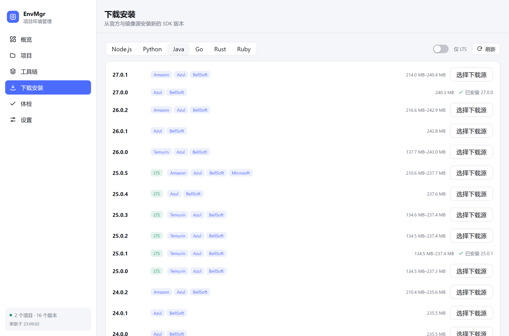
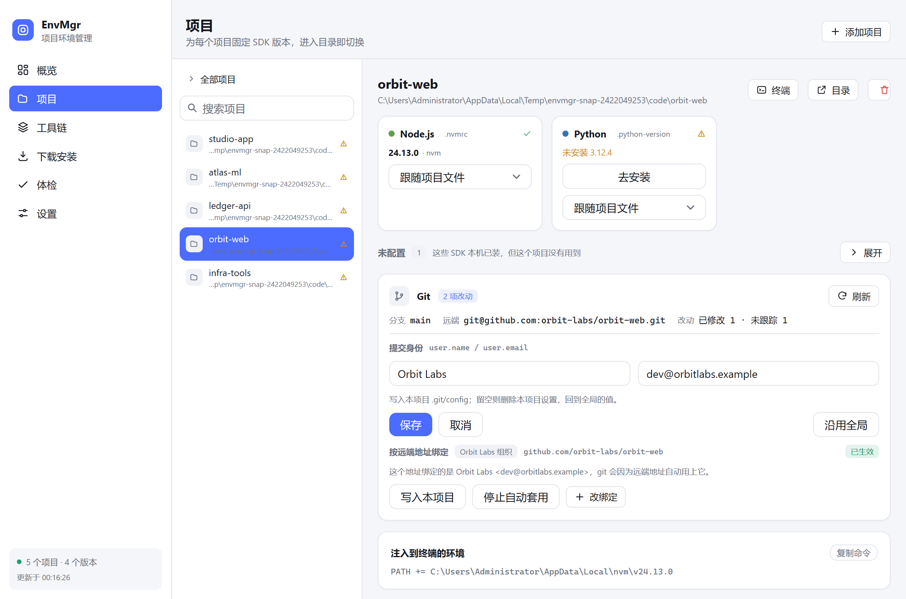
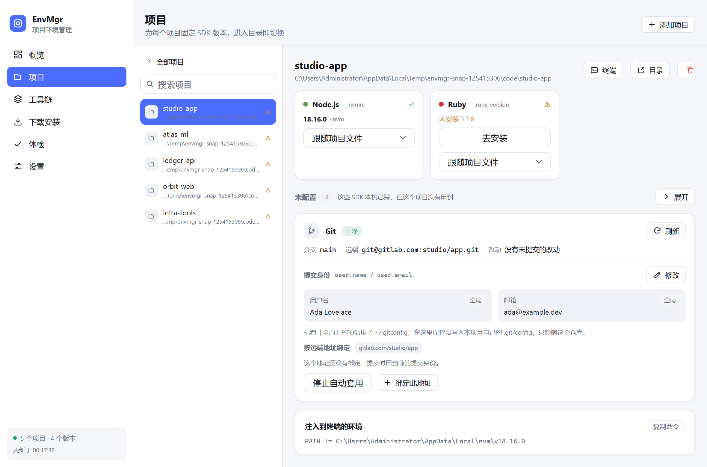
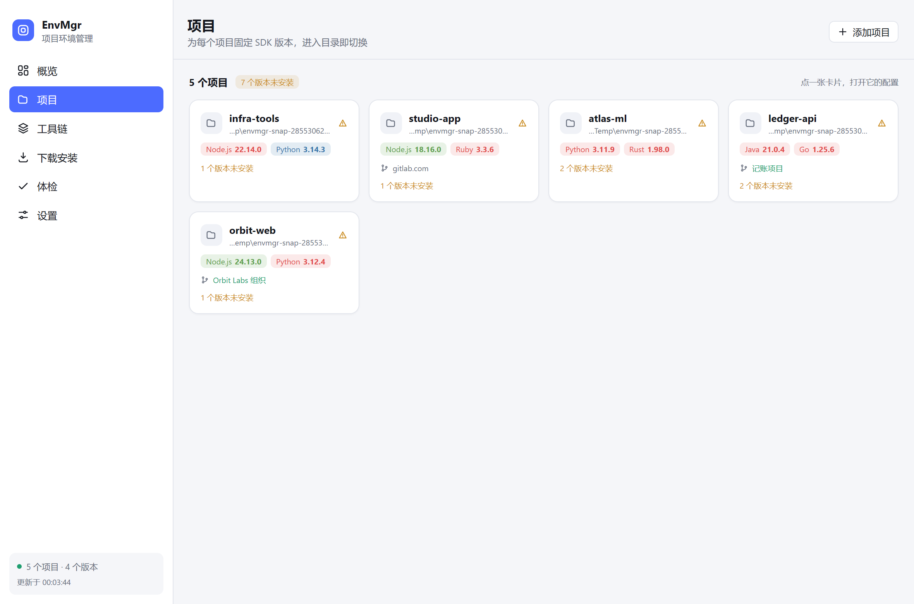
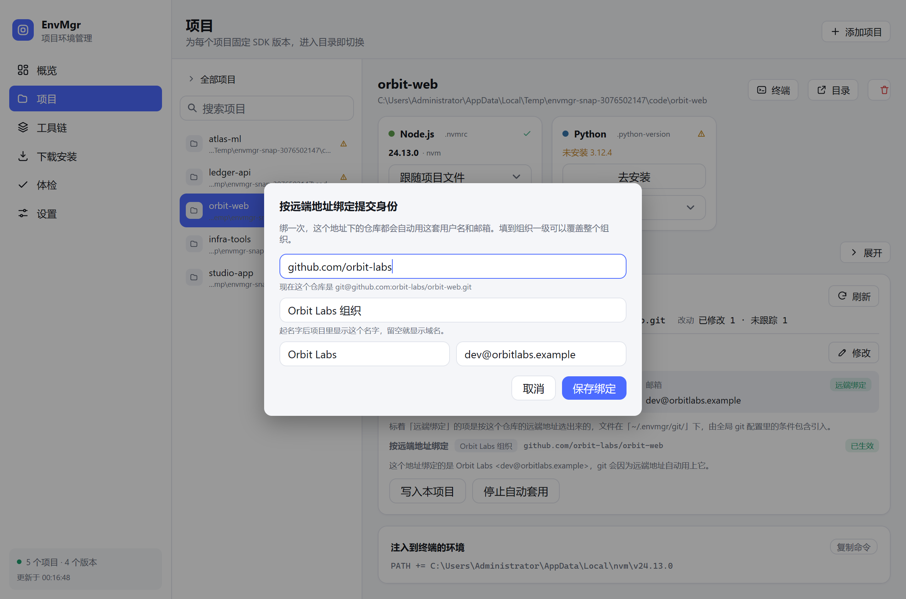
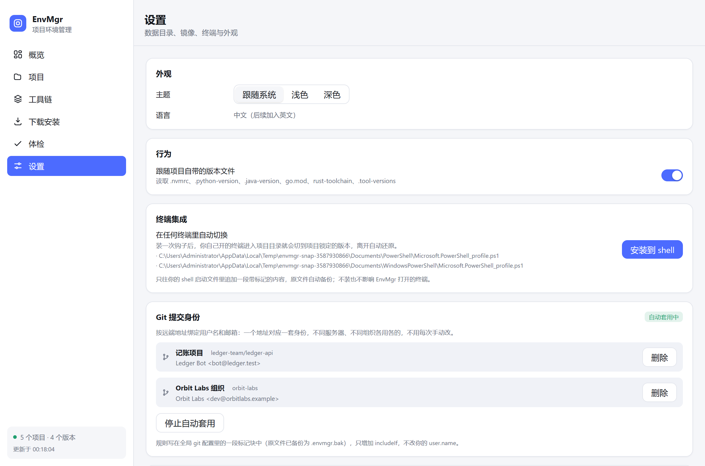

# EnvMgr · 项目环境管理

按项目切换 SDK 版本，不动全局环境变量。Windows、macOS、Linux 同一个可执行文件，Go + mygo 原生 GPU 界面，无 cgo、无 WebView。

```
┌ EnvMgr ─────────────────────────────────────────────┐
│ 概览   项目环境、已装 SDK 与需要处理的问题           │
│ ─────────────────────────────────────────────────── │
│ 读取项目已有的 .nvmrc / .python-version / java-version │
│ 进入目录自动切换；不动全局环境变量                     │
└─────────────────────────────────────────────────────┘
```

## 它解决什么

同一台机器上，A 项目要 Node 18，B 项目要 Node 24，C 项目要 Python 3.11，D 项目要 Python 3.12。改全局 PATH 只能让一个项目赢，且会悄悄弄坏别的项目。

EnvMgr 的做法：

- 每个项目的版本写在项目里（`.envmgr.json`，或项目原有的 `.nvmrc`、`.python-version`、`go.mod`、`rust-toolchain.toml`、`.tool-versions`……）。
- 需要环境时，把该项目的 SDK 目录**临时**放到 PATH 最前面 —— 只对这个终端、这个进程有效。
- 系统环境变量、`~/.bashrc`、`~/.zshrc`、注册表 PATH 一律不写。是否安装 shell 钩子由你自己决定，钩子内容只打印给你看，不代写。

## 界面

五个页面，鼠标能做完所有事：

| 页面 | 用途 |
| --- | --- |
| 概览 | 项目数、已装版本数、待处理缺失版本、最近项目、各 SDK 最新版本 |
| 项目 | 左侧项目列表（可搜索），右侧按 SDK 选版本；卡片上显示每个项目的提交地址（有名字显示名字，没名字显示域名）；Git 卡显示仓库状态、提交身份与远端地址绑定 |
| 工具链 | 本机所有已装版本及其来源（envmgr / nvm / fnm / pyenv / jenv / sdkman / rustup / PATH…）；版本管理器一键安装 |
| 下载安装 | 从官方源列版本、下载、校验、安装；Java 多来源可选；LTS 过滤；内联进度 |
| 设置 | 主题（跟随系统/浅色/深色）、跟随项目文件开关、SDK 安装目录、Node 镜像、shell 钩子片段、Git 地址绑定管理 |

浅色深色都跟随系统，也可以手动锁定。

## 下载安装

顶部是 SDK 标签（Node.js / Python / Java / Go / Rust / Ruby）。切标签时页面会自己判断该显示谁的数据：每帧问一次「当前标签的列表在手上了吗」，没有就拉，拉过就直接用缓存 —— 切回上一个标签不会重新请求。

判断逻辑抽成了 `remoteActionFor`，有五种答案：显示列表 / 等待中 / 显示错误 / 用缓存 / 去拉取。这样 tab 切换、从项目页跳进来、点「刷新」都走同一条路，不依赖某个控件的回调有没有触发。

### Java 是多来源的

同一个 Java 版本由多个厂商各自构建，补丁节奏和许可证都不同，所以 Java 的列表是**版本 × 来源**的矩阵：一行一个版本，行内是能提供这个版本的厂商，点「选择下载源」再选具体构建。




| 来源 | 地址 | 能列出 |
| --- | --- | --- |
| Eclipse Temurin | `api.adoptium.net` | 每个大版本的完整小版本历史 |
| Amazon Corretto | `corretto.aws` | 每个大版本的最新构建 |
| Azul Zulu Community | `api.azul.com/metadata` | 完整小版本（已剔除 CRaC / JavaFX 变体） |
| BellSoft Liberica JDK | `api.bell-sw.com` | 完整小版本（只取普通 JDK 压缩包） |
| Microsoft Build of OpenJDK | `aka.ms/download-jdk` | 每个大版本的最新构建 |

覆盖 Java 8 / 11 / 17 / 21 / 25 / 26 / 27 等，一共约 380 个构建。四个细节值得说明：

- **版本号归一**：Corretto 报 `21.0.13.0.11`、Liberica 报 `21.0.13+11`、Microsoft 报 `21.0.13.0.2`，归一成 `21.0.13` 才并得成一行。
- **一个源挂了不影响整页**：任一厂商取列表失败只记下原因，别的厂商照常显示；全部失败才报错。
- **同版本不同源不打架**：默认源（Temurin）装到 `~/.envmgr/sdk/java/<版本>`，其他源装到 `<版本>-<来源>`，两个构建可以并存。
- **Adoptium 的分页要小页翻**：它的 `page_size` 一大就会跳进历史中段、甚至直接 404，用 30 去取会把 Java 21/25/27 取成空列表。现在固定用小页（每页 3 条）逐页往回翻，最多 18 个构建 —— 这既是修掉「21 之后一个都没有」的原因，也让每个大版本都有从新到旧的完整序列。

命令行同样能指定来源：

```bash
envmgr list --remote java           # 列出来源与版本
envmgr install java@21.0.13@corretto
```

IBM Semeru 与 Oracle 的 OpenJDK 构建没有稳定的公开版本索引（Semeru 只有 Java 8 的部分索引，Oracle 的下载地址带不可推导的 hash），所以没有列入；用「导入本机已装」仍然可以纳管它们。

## 项目页

项目页是两级：默认是卡片墙，点开一张卡才进入配置。

**卡片墙**：四栏网格，所有项目一屏铺开。每张卡显示项目名、路径、它固定了哪些版本、以及还有几个版本没装。缺失的卡片带一个橙色感叹号，一眼能看出哪个项目跑不起来。

**项目配置**：列表收缩成左侧窄栏（仍可搜索、仍标注缺失），右侧是该项目自己的配置：

- 三栏卡片，一张卡一个 SDK —— 颜色点、来源（`pin` / `.nvmrc` / `go.mod` 等）、当前解析到的版本与来源管理器、切换下拉。
- 这个项目**没用到的** SDK 收在「未配置 N」后面，默认折叠；点「展开」才显示，并且用淡色画出来 —— 它们在本机可用，只是这个项目不关心。

### 项目里的 Git

SDK 版本对了，下一个岔子通常是 git：`git commit` 报 `Please tell me who you are`，或者在别人的机器上提交出一个不属于这个项目的邮箱。所以项目页里有一张 Git 卡，只回答两件事 —— 这个目录是不是仓库，下一次提交会署谁的名。

| 状态 | 卡片长什么样 |
| --- | --- |
| 没装 git | 「未安装」，给一个 git-scm.com 的入口 |
| 目录不是仓库 | 「不是仓库」+「初始化 Git 仓库」按钮，说明只创建 `.git`、不动项目文件 |
| 刚 `git init` | 「还没有提交」—— 还没提交过的仓库不该被当成游离 HEAD |
| 游离 HEAD | 「游离 HEAD」，不会把 `HEAD` 当成一个分支名显示 |
| 有提交、干净 | 「干净」+ 分支名 |
| 有改动 | 「N 项改动」+「已暂存 / 已修改 / 未跟踪」分别计数 |


**身份来自哪一级，卡片直接标出来**。这是它存在的理由：git 本身没有「项目身份」这个概念，`user.name` 只有仓库级和全局两级，项目里的值是继承来的。卡片对每一项单独标注来源：

- 标「本项目」—— 写在 `.git/config` 里，只影响这个仓库；
- 标「全局」—— 沿用 `~/.gitconfig`，这台机器上所有仓库共用；
- 标「未设置」—— 两级都没有，`git commit` 会直接拒绝执行。

点「修改」写的就是 `.git/config`，**永远不碰全局配置**。留空保存等于删掉本项目这一级，值会立刻回退到全局 —— 和 git 自己的行为一致，不用记另一套规则。





两个实现上的细节值得说：

- **分支名用 `symbolic-ref --short HEAD` 读，不用 `rev-parse --abbrev-ref HEAD`**。后者在刚 `git init`、一次提交都还没有时返回 `HEAD`，会被误判成游离头指针。实测确认过：新建仓库的 `symbolic-ref` 给出 `master`，`abbrev-ref` 给出 `HEAD`。
- **`git status --porcelain` 的输出不能 `TrimSpace`**。它的第一列是暂存区状态，`" M file"`（已修改）前面那个空格是数据；统一 trim 掉就变成 `"M file"`（已暂存），计数全错。这个 bug 是真 git 测试抓出来的，不是想出来的。

`git status` 在大型仓库上要花上百毫秒，所以读结果带缓存：第一次读同步取（页面的首帧就要正确），之后过期先返回旧值、后台再读一遍，绘制线程从不等待 git。「刷新」按钮走的是后台读。

命令行同一份能力：

```bash
envmgr git                          # 当前目录的仓库状态与提交身份
envmgr git app                      # 按项目名查
envmgr git init --dir <目录>        # 变成仓库
envmgr git set --name 张三 --email z@ex.com --dir <目录>
                                    # 只写本项目的 user.name / user.email
envmgr git set --clear --dir <目录>  # 删掉本项目设置，回到全局
```

### 按远端地址绑定身份

同一个人的名字和邮箱往往不止一套：公司组织下要署工号邮箱，自己的仓库要署私人邮箱。逐个仓库 `git set` 记不住也容易漏，所以 EnvMgr 允许把一套身份**绑定到一个远端地址**上，地址就是 key。

地址会被归一化：去掉协议、凭据、端口和结尾的 `.git`，主机小写。所以 `git@github.com:acme/app.git`、`https://github.com/acme/app`、`ssh://git@github.com:2222/acme/app.git` 是同一个 key `github.com/acme/app`。地址可以写到一个组织或一个人，也可以写到单个仓库，**越具体越优先**：

| 绑定 | 命中 | 不命中 |
| --- | --- | --- |
| `github.com` | 该主机下所有仓库 | —— |
| `github.com/acme` | `acme/app`、`acme/team/web` | `other/app` |
| `github.com/acme/app` | 只有 `acme/app` | `acme/other` |



项目卡片上直接能看到每个项目的提交地址：**有名字显示名字，没名字显示域名**。绿色的「记账项目」「Orbit Labs 组织」是已经绑定的，灰色的 `gitlab.com` 是没绑定的 —— 一眼就能看出哪些项目还在用默认身份。

点「绑定此地址」填名字、用户名、邮箱：



绑定能自动生效，靠的是 git 自己的 `includeIf "hasconfig:remote.*.url:<glob>"` —— 这是 git 唯一提供的「按远端地址选配置」机制（2.36 起）。EnvMgr 做的是：

1. 每条绑定写一个身份文件到 `~/.envmgr/git/<地址>.gitconfig`；
2. 在全局 git 配置里写入一段**带标记的块**，里面只有 `includeIf` 指向这些文件；
3. 原全局配置先备份成 `.envmgr.bak`，块每次保存都整段重建，不会重复堆积。

这里有个取舍要说清楚：**这一步确实会写全局 git 配置**。不是环境变量，也不会改你的 `user.name` —— 只是增加若干 `includeIf`。之所以必须写全局，是因为 git 没有任何仓库级的「按地址选身份」机制，`--local` 只能写死一套。块是带标记的，点「停止自动套用」就整段移除，实测卸载后全局配置逐字节回到原样，你自己手写的 `includeIf` 不受影响。

三种状态的措辞是分开的，因为差别很实际：

| 卡片上写的 | 含义 |
| --- | --- |
| 已生效（绿） | 地址有绑定，规则也装了，git 现在就用这套 |
| 已绑定但规则未安装（黄） | 绑定存着，但 git 还没装上规则，**还不生效** —— 不写这句就是骗人 |
| 没有绑定 | 地址下没有绑定，提交仍用当前身份 |

身份来源因此多了一级，优先级是：**本项目 `.git/config` > 远端绑定 > 全局**。卡片上分别标「本项目」「远端绑定」「全局」，来源判定用的是 `git config --show-origin`，不是猜的 —— 它直接给出是哪个文件回答的，所以远端绑定和全局继承分得清。

两个坑是真 git 测出来的，不是推的：

- **仓库级 key 必须额外生成带 `.git` 的规则**。key 里 `acme/app` 没有后缀，而 `acme/app/**` 要求路径后面还有斜杠；真实 clone 地址是 `acme/app.git`，`.git` 不是斜杠，于是规则不命中 —— 绑定看起来存了，git 却不理。现在每个地址同时生成 `…/app/**`、`…/app.git` 和 `…/app` 三种，少一种就漏。这个缺口是端到端测试抓出来的（组织级绑定能命中，所以只测组织级看不出来）。
- **`--global --get` 会把规则的值当成全局值**。仓库命中规则时，`git config --global --get user.name` 返回的是规则里的名字。要拿到「规则不存在时会用什么」，必须 `git config --file <全局配置路径> --get`，绕过条件包含。编辑器的「沿用全局」提示读的是后者。

命令行：

```bash
envmgr git profile add github.com/acme --label 公司账号 --name 张三 --email z@acme.com
envmgr git profile add git@github.com:me/dotfiles.git --name 张三 --email me@home.dev
envmgr git profile list             # 列出所有绑定，带 * 的是起了名字的
envmgr git profile rm github.com/acme

envmgr git rules status             # 自动套用装了没、git 版本够不够
envmgr git rules install            # 让 git 按地址自动选择身份
envmgr git rules uninstall          # 整段移除，全局配置回到原样
```



`envmgr git status` 也会显示这一级来源：

```
远端  git@github.com:acme/app.git
地址  github.com/acme/app
用户名  Acme Dev（远端绑定）
邮箱    dev@acme.test（远端绑定）
```

## 体检

窗口的「体检」页把 EnvMgr 依赖的每一项配置逐条查一遍，命令行是同一份结果：

```bash
envmgr doctor                 # 全部检查项
envmgr doctor --dir <目录>    # 只看某个目录解析成什么
```

检查分六组，有问题和需要注意的排在前面：

| 分组 | 查什么 |
| --- | --- |
| 运行环境 | Go 版本、OS/架构、可执行文件位置 |
| 数据与存储 | 配置目录与 SDK 目录能否创建和写入、状态文件大小、下载缓存占用 |
| 终端集成 | 当前 shell、每个 profile 的钩子是否安装、是否有 BOM、钩子调用的程序是否还在、进入提示开关、可用终端 |
| 工具链 | 每种 SDK 发现了几个版本、哪个一种都没有 |
| 项目 | 每个项目的版本声明能否落地、缺失的具体版本、手动添加的记录 |
| 设置与环境变量 | 跟随版本文件、SDK 目录、Node 镜像、`GOROOT`/`JAVA_HOME` 等是否指向已消失的目录 |

状态分四级：正常、注意、有问题、信息。能自动处理的项目会直接给按钮（安装终端钩子、重新扫描、打开目录），其余只给说明 —— 比如系统环境变量 EnvMgr 不会去改，只把问题指出来。

## 命令行

窗口之外，同一份核心逻辑也提供命令，方便写进脚本和 CI：

```bash
envmgr                                   # 打开窗口
envmgr env --shell pwsh                  # 打印激活脚本，交给 shell 执行
eval "$(envmgr env)"                     # bash / zsh 里直接生效
envmgr run -- npm test                   # 用项目的 Node 跑一条命令
envmgr use node@20.11.1 python@3.12.4    # 固定版本，写入 .envmgr.json
envmgr list                              # 本机已装
envmgr list --remote node                # 官方源可装的版本
envmgr install python@3.12.4             # 下载并安装
envmgr remove node@20.11.1               # 删除 EnvMgr 装的版本
envmgr doctor                            # 每个项目要的版本是否都在本机
envmgr hook bash                         # 打印可选安装的 shell 钩子
envmgr git                               # 当前目录的仓库状态与提交身份
envmgr git init                          # 把当前目录变成 Git 仓库
envmgr git set --name 张三 --email z@ex.com  # 只写本项目的 user.name / user.email
envmgr add ~/code/app                    # 加入项目列表
envmgr scan ~/code                       # 在目录下找工作项目
envmgr add-version java ~/env/java/17    # 登记一个不在常规位置的已安装版本
envmgr forget-version java ~/env/java/17 # 取消登记（不删磁盘文件）
```

`envmgr run` 会把命令解析到**项目固定的那个版本**上（先按覆盖后的 PATH 找可执行文件，再启动），退出码原样返回，可以直接放进脚本。

## 添加已安装的版本

自动扫描覆盖常规位置，但每个人的机器都有自己的放法。工具链页右上角的 **＋ 添加已安装版本** 用来补这个缺口：

1. 选 SDK 类型
2. 选目录（原生目录对话框）
3. 版本号留空即从目录自动识别

登记后它和扫到的版本完全一样：能显示来源「手动添加」、能给项目固定、能被 `envmgr run` 用上。移除时只从列表里去掉，**磁盘文件不碰** —— EnvMgr 没创建它，就不该删它。

## 自动扫描的范围

| SDK | 扫描位置 |
| --- | --- |
| Node | `~/.envmgr/sdk/node`、`$NVM_DIR/versions/node`、`$NVM_HOME`、`%APPDATA%/nvm`、fnm、n、volta、asdf、mise |
| Python | `~/.envmgr/sdk/python`、pyenv、asdf、mise、uv、`%LOCALAPPDATA%/Programs/Python`、`C:\Python3xx`、macOS Framework |
| Java | `~/.envmgr/sdk/java`、jenv、sdkman、asdf、mise、`/usr/lib/jvm`、**`~/env/java`（多版本并列的常见布局）**、`~/.jdks`、`~/java`、`~/jdks`、`C:\Program Files\{Java,Eclipse Adoptium,Microsoft,Zulu,Amazon Corretto,BellSoft}` |
| Go | `~/.envmgr/sdk/go`、`~/sdk`、asdf、mise、`~/env/go`、`~/go/sdk`、`/usr/local/go`、`GOROOT`、**`GOTOOLCHAIN` 模块缓存** |
| Rust | `~/.envmgr/sdk/rust`、rustup、asdf、mise、PATH |

Java 目录额外识别几种包装结构：`Contents/Home`（macOS 包）、`Home`、`jre` 子目录，以及目录里再套一层版本目录的归档式布局。版本号优先读 `release` 文件里的 `JAVA_VERSION`，读不到再看目录名。

### Go 的 1.27.3 是从哪来的

`go.mod` 里写 `go 1.27.3`，而本机 GOROOT 是 1.25.6 时，Go 自己会下载这份工具链，放在

```
%USERPROFILE%\go\pkg\mod\golang.org\toolchain@v0.0.1-go1.27.3.windows-amd64
```

`go env GOROOT` 指的就是这里 —— 它不是常规安装，但确实是一个能编译的工具链，所以 EnvMgr 照样列出来，来源标成「Go 工具链缓存」。要一个正经安装，就去下载页装一份到 `~/.envmgr/sdk/go`。

## 终端按钮怎么拿到正确版本

「终端」按钮打开的窗口里，SDK 就是项目固定的那个。这件事比看起来难，因为**多数现代终端不是自己去启动 shell 的**：

- Windows Terminal 是单实例程序。`wt -d 目录` 只是把请求转交给已经在跑的进程，新标签页由**那个进程**创建，调用方传的环境变量被整份丢弃。
- Linux 的 gnome-terminal 同理，真正的父进程是常驻的 `gnome-terminal-server`。
- macOS 的 Terminal.app 也不继承调用方的环境。

所以「启动终端时带上环境」这条路根本走不通 —— 走通的是让 **shell 自己应用**环境：EnvMgr 把环境写成一份脚本放到 `~/.envmgr/activate/`，再让新 shell 以「加载这份脚本」的方式启动。Windows Terminal 用 `pwsh -NoExit -File <脚本>`，Linux 用 `sh -c '. <脚本>; exec $SHELL'`，macOS 用生成的 `sh` 脚本。脚本名按环境内容哈希，同一个项目的环境复用同一个文件。

脚本在 shell 的 profile 之后执行，所以即使用户 profile 里改过 PATH，项目的版本依然排在前面。

### 让「自己开的终端」也生效

上面说的是 EnvMgr 打开的终端。你自己开的终端要自动切换，需要装一次钩子：

```bash
envmgr hook pwsh --install     # 写入 shell 启动文件（原文件自动备份）
envmgr hook pwsh               # 看状态：每个启动文件是否已装
envmgr hook pwsh --uninstall   # 移除，只删自己那段
```

装好后进入带版本声明的目录自动切换，离开自动还原 —— 每次切目录先回到基线再叠加，反复进出不会让 PATH 越滚越长。

Windows 上有个必须处理的地方：**PowerShell 5.1 和 PowerShell 7 用的是不同的 profile，一台机器通常两个都在**，而你的终端可能是其中任意一个。所以安装会写进**所有已存在的** profile：

```
~\Documents\PowerShell\Microsoft.PowerShell_profile.ps1          (PowerShell 7)
~\Documents\WindowsPowerShell\Microsoft.PowerShell_profile.ps1   (Windows PowerShell 5.1)
```

并且写入时带 **UTF-8 BOM**。5.1 在没有 BOM 时按 ANSI 解码，块里的中文注释会变成乱码，整段脚本解析失败、静默不生效 —— 这个坑踩过一次。

进入项目时会给一行彩色提示，每种 SDK 用自己的颜色：

```
  ◆ EnvMgr  manager
    java 21.0.9 · go 1.27.4
```

颜色只在终端里显示，重定向或管道里是纯文本，不会污染脚本输出。嫌吵就设 `ENVMGR_NO_BANNER=1`（或写进 profile），提示关掉、切换照常。

EnvMgr 自己打开的终端（终端按钮）也打印同一行提示 —— 用的是同一份 overlay，两种入口看到的东西一致。

钩子里调用的是 EnvMgr 的绝对路径（因为 EnvMgr 所在目录通常不在 PATH 上），所以**移动了 `envmgr.exe` 之后要重装一次钩子**。

`envmgr env`、`envmgr run`、终端按钮、钩子走的是同一份 overlay，四处行为一致。

## 构建

```bash
go build -o envmgr ./cmd/envmgr          # 当前平台
```

要求 Go ≥ 1.27.3（mygo 的下限）。跨平台全部通过 `CGO_ENABLED=0` 交叉编译：

```bash
GOOS=windows GOARCH=amd64 CGO_ENABLED=0 go build -trimpath -ldflags "-s -w" -o dist/envmgr-windows-amd64.exe ./cmd/envmgr
GOOS=linux   GOARCH=amd64 CGO_ENABLED=0 go build -trimpath -ldflags "-s -w" -o dist/envmgr-linux-amd64       ./cmd/envmgr
GOOS=darwin  GOARCH=arm64 CGO_ENABLED=0 go build -trimpath -ldflags "-s -w" -o dist/envmgr-darwin-arm64      ./cmd/envmgr
```

产出约 12–14 MB，静态链接，不需要运行时装任何 SDK 或 WebView。

## 数据放在哪

| 内容 | 位置 |
| --- | --- |
| 配置与项目列表 | `~/.envmgr/state.json`（原子写入，损坏时保留 `.bad` 备份） |
| EnvMgr 装的 SDK | `~/.envmgr/sdk/<kind>/<version>` |
| 版本管理器 | `~/.envmgr/managers/<id>` |
| 下载缓存 | `~/.envmgr/downloads` |
| Rust 私有工具链 | `~/.envmgr/.rustup`、`~/.envmgr/.cargo` |
| Git 地址绑定的身份文件 | `~/.envmgr/git/<地址>.gitconfig` |

安装目录可在设置里改。EnvMgr 只写这些目录。

## 支持的 SDK 与来源

| SDK | 发现 | 下载安装 |
| --- | --- | --- |
| Node.js | envmgr、nvm、nvm-windows、fnm、n、volta、asdf、mise、PATH | nodejs.org/dist（可换镜像），带 SHASUMS256 校验 |
| Python | envmgr、pyenv、uv、asdf、mise、PATH | python-build-standalone 官方 release |
| Java | envmgr、jenv、sdkman、asdf、mise、JAVA_HOME、系统目录 | Eclipse Temurin、Amazon Corretto、Azul Zulu、BellSoft Liberica、Microsoft Build of OpenJDK |
| Go | envmgr、`~/sdk`、GOROOT、asdf、mise | go.dev/dl |
| Rust | envmgr、rustup、asdf、mise、PATH | 通过私有 `RUSTUP_HOME` 装 rustup |
| Ruby | envmgr、rbenv、rvm、asdf、mise、系统目录 | 仅发现与导入（官方无免编译二进制） |

版本表达式支持 `20.11.1`、`20`、`20.x`、`^18`、`~1.2`、`>=18 <21`、`18 || 20`、`lts`。

## 验证方式

- `go test ./internal/core/` —— 版本比较与匹配、标记文件解析、PATH 覆盖与去重、zip-slip 防护、解包展平、项目内 pin 优先于标记文件、`LookPath` 优先使用覆盖后的 PATH。
- `go test ./internal/core/` 里还有一组**真 git** 测试：临时仓库里跑 `git init`、写项目级 `user.name`/`user.email`、读回来、清空再确认回退到全局；用 `GIT_CONFIG_GLOBAL`/`GIT_CONFIG_SYSTEM` 指向临时文件，绝不读写本机真实的 `~/.gitconfig`。
- `go vet ./...`、`gofmt -l` 干净。
- 五个平台目标 `CGO_ENABLED=0` 交叉编译通过。
- 离线渲染：`go run ./cmd/snap -out shots` 用 `ui.Render` 把每个页面渲染成 PNG（浅色/深色），不打开窗口即可检查版式；`-project-name <名字>` 可以指定项目，`-git-edit` 展开身份编辑器，`-git-bind` 打开地址绑定对话框。
- 运行时取证：窗口进程不加载任何 WebView2 模块，不产生 Edge 子进程 —— 界面是 Direct3D 11 直接绘制的。
- 端到端实测：真实下载 Node LTS（39 MB）、SHA256 校验、解包、装进 `~/.envmgr/sdk/node/26.13.1`；随后 `envmgr run -- node -v` 在项目内得到 `v26.13.1`，项目外仍是全局的 `v24.13.0`。
- 端到端实测（Git）：隔离的临时 HOME 里 `envmgr git init` → `envmgr git set --name/--email` → `git config --local` 读回写入值 → `--clear` 后确认仓库级设置被删除、全局值重新生效。
- 端到端实测（地址绑定）：同一套临时 HOME 里建两个远端不同的仓库，装好规则后让**真 git** 自己回答 `git config --get user.name` —— 组织级绑定命中 `acme/app.git`、`acme/other.git`、`https://…`、`ssh://…:2222/…`、`https://token@…` 五种写法；仓库级绑定只命中自己，同组织的兄弟仓库仍是全局身份；未绑定的主机回退全局。卸载后全局配置逐字节回到原样，手写的 `includeIf` 保留。
- 回归测试守住了那个漏规则的坑：`TestRulesSelectIdentityByRemote` 里同时有组织级和仓库级绑定，仓库级那条的远端带 `.git`、key 不带 —— 只测组织级的话这个缺口看不出来。

## 代码结构

```
cmd/envmgr      窗口入口 + CLI 分发
cmd/snap        离线截图工具（ui.Render → PNG）
internal/core   纯逻辑：发现、解析、下载、安装、环境覆盖、shell 集成、Git 仓库读取与地址绑定
internal/cli    命令行子命令
internal/app    界面：状态、五个页面、动作与对话框
_notes          mygo API 备忘（编译验证过的速查表）
```

`internal/core` 不依赖界面，可单独测试，也可被其他程序复用。

## 一点设计取舍

- **不接管 shell**：钩子是可选的、打印出来的片段。装上它才有「进目录自动切换」，不装就完全无感。
- **不猜版本**：探测不到版本的目录不会被列出来。宁可少一个条目，也不在界面上显示一个错版本号。
- **安装目录自持**：EnvMgr 装的 SDK 都在自己的目录里，删除即干净，不影响 nvm/pyenv 的既有布局。
- **管理器只装官方发行版**：`n`、`volta`、`mise` 这类通过 npm/脚本自举的，给出官方命令和链接，不代替你执行。
- **Git 身份默认只写仓库级**：`user.name`/`user.email` 一律用 `git config --local` 写进项目自己的 `.git/config`。要按远端地址自动选身份时，才在全局 git 配置里加一段带标记的 `includeIf` 块 —— 这是 git 唯一支持的机制，没有仓库级的等价物；块可整段移除，原文件留 `.envmgr.bak` 备份，你自己的 `user.name` 一个字不动。
- **地址绑定用地址当 key，不用项目名**：项目会改名、会被删掉重新 clone，远端地址才是稳定且可推导的那个东西。名字（`--label`）只是给人看的显示层，不参与匹配。
- **Git 命令不阻塞绘制**：读结果带缓存，首次同步取，之后过期先返回旧值、后台刷新。`git status` 在大仓库上慢，卡在绘制线程里就是肉眼可见的卡顿。
